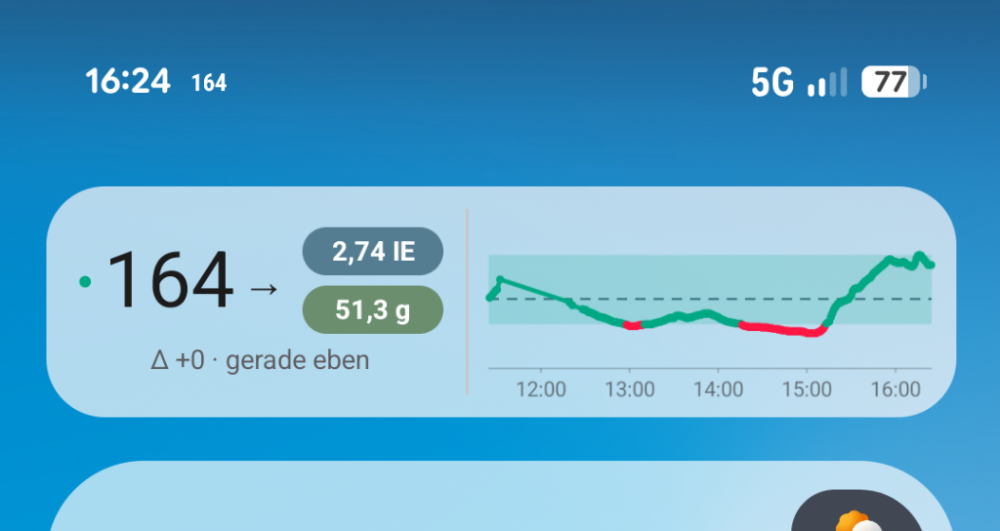
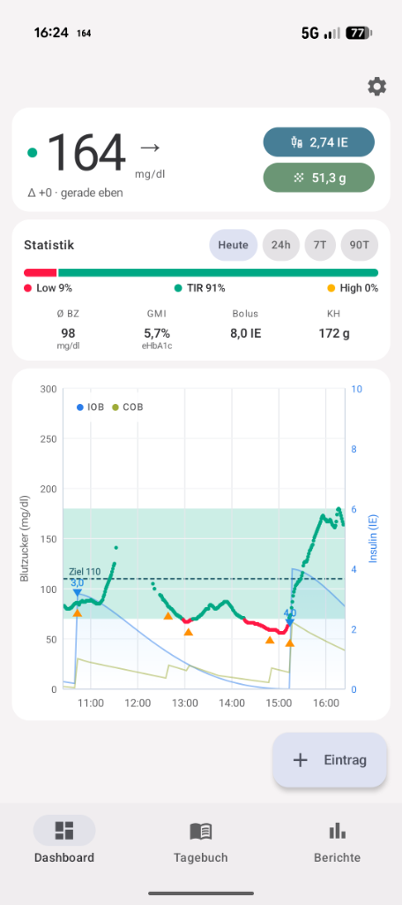
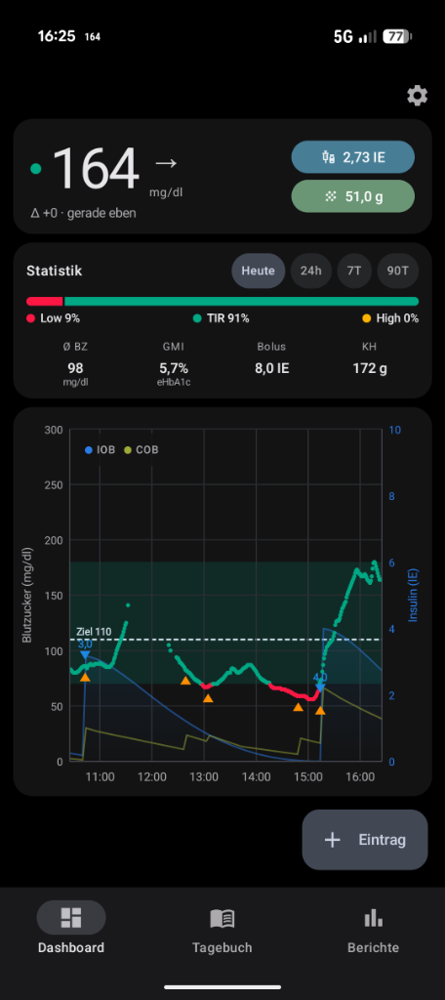
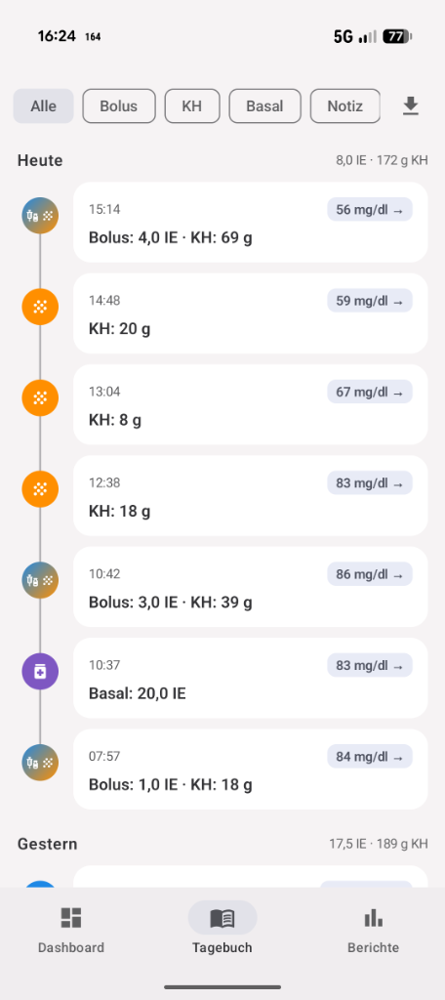
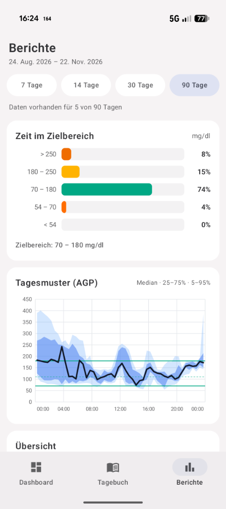
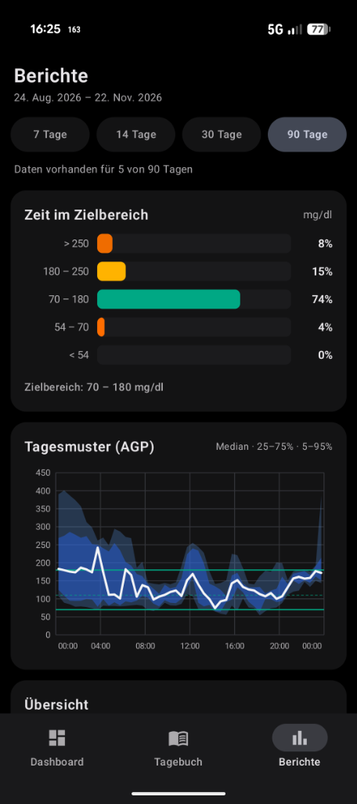
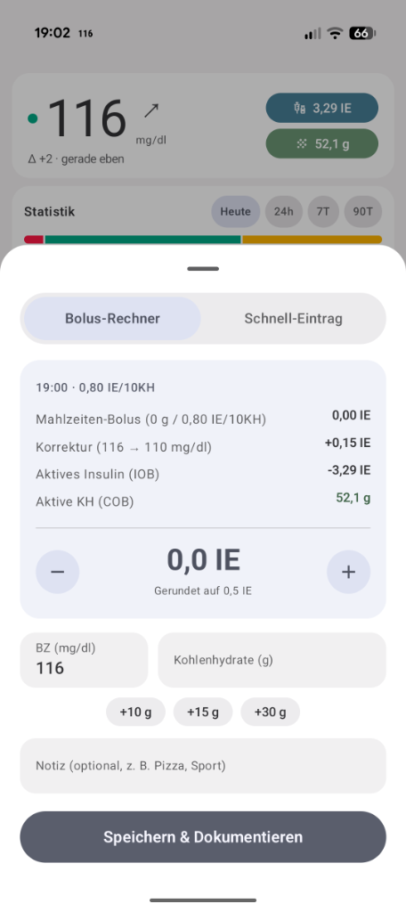
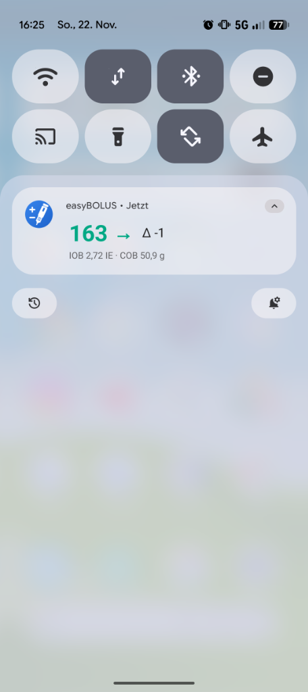
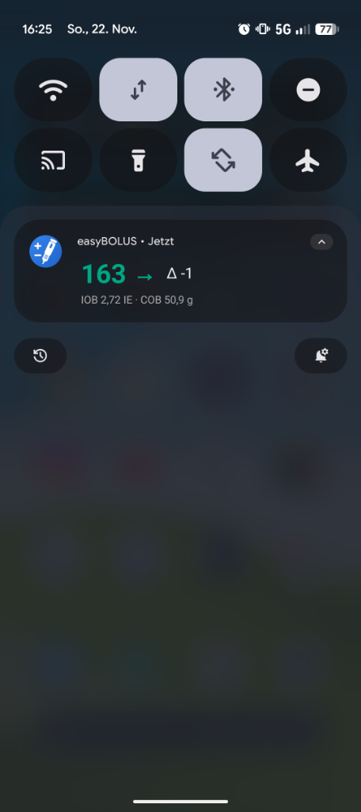

# easyBOLUS

**Version 1.2.0** · Entwickelt vollständig mit **Antigravity**

Eine moderne, schlanke Android-App (Jetpack Compose / Material 3) zur schnellen Bolus-Berechnung, Dokumentation von Kohlenhydraten, Bolus- & Basal-Insulin, detaillierten Berichten (TIR & AGP) sowie zur Live-Anzeige von CGM-Glukosewerten aus **Juggluco / xDrip** – oder komplett manuell ohne Sensor.

> **Wichtiger Hinweis:** easyBOLUS ist ein privates Hilfs- und Dokumentationstool und **kein zertifiziertes Medizinprodukt**. Überprüfe alle berechneten Bolus- und KH-Vorschläge eigenverantwortlich und triff Therapieentscheidungen nicht allein auf Basis dieser App.

> **Built with Antigravity:** Diese App – von der Architektur über die Berechnungslogik und das Material-3-Design bis hin zu Widget, Benachrichtigungen, Berichten und Unit-Tests – wurde **vollständig mit Antigravity** gebaut.

---

## Screenshots

### Startbildschirm-Widget & Statusleiste

<p align="center">
  
</p>

### App-Ansichten (Hell & Dunkel)

| Dashboard (Hell) | Dashboard (Dunkel) | Tagebuch |
| :---: | :---: | :---: |
|  |  |  |

| Berichte (Hell) | Berichte (Dunkel) | Bolus-Rechner |
| :---: | :---: | :---: |
|  |  |  |

| Benachrichtigung (Hell) | Benachrichtigung (Dunkel) |
| :---: | :---: |
|  |  |

---

## Funktionen

- **Dashboard & Live-Verlauf (7 Tage)**
  - Großer Live-Blutzuckerwert mit farbigem Statuspunkt, Trendpfeil, **`Δ`-Delta**, Zeitstempel sowie **IOB** (*Insulin on Board*) und **COB** (*Carbs on Board*) als kompakte Badges.
  - Veraltete CGM-Werte (> 15 Min.) werden automatisch als `---` markiert.
  - **Kompakte Statistik-Leiste** für **Heute**, **24h**, **7 Tage** und **90 Tage** (Low / TIR / High, Ø BZ, GMI / eHbA1c, Bolus & KH).
  - **Interaktiver Dual-Axis-Chart** über die letzten **7 Tage** mit automatischer Y-Achsen-Skalierung, Zwei-Finger-Zoom (bis 24 h), freiem Verschieben (Pan), Crosshair-Inspektion und dezenten IOB-/COB-Kurven.
  - Kontrastreiches **Warnrot** für Unterzuckerungen – optimiert für gute Unterscheidbarkeit bei Rot-Grün-Sehschwäche.
- **Bolus-Rechner & Schnell-Eintrag**
  - Berechnet Mahlzeiten- und Korrekturbolus anhand von Zielwert, ISF, aktivem **IOB** (exponentielle Wirkungskurve für Schnell / Ultra-Schnell) und **Tages- oder stündlichen Faktoren (00–23 Uhr)**.
  - Wahlweise Eingabe als **`KH/IE`**, **`IE/10KH`** oder **`IE/BE` (1 BE = 12 g KH)** inkl. automatischer Umrechnung für Tages- und 24-Stunden-Faktoren.
  - **KH-Empfehlung unter Berücksichtigung von COB:** Wenn BZ oder überschüssiges IOB unter den Zielwert führen, zeigt der Rechner die benötigten Gramm KH an (abzüglich bereits aktiver COB) – per Tipp direkt übernehmbar.
  - Rundung auf die eingestellte **Pen-Schrittweite** (`0,5 IE` oder `1,0 IE`) inkl. `− / +`-Stepper und kurzer Spritzerinnerung nach dem Speichern.
  - **Basal-Standardwert** in den Einstellungen festlegbar und im Schnell-Eintrag direkt vorausgefüllt.
- **Berichte (Libre-3-Stil)**
  - Direkt über den **Berichte**-Tab in der unteren Navigationsleiste erreichbar (**7 / 14 / 30 / 90 Tage**, Standard 90 Tage).
  - **5-stufige Zeit im Zielbereich (TIR)**, **24-Stunden-Tagesmuster (AGP)** mit Median sowie `25–75 %`- und `5–95 %`-Perzentilen und Übersichtskennzahlen (`Ø BZ`, `GMI`, `CV %`, `Ø Bolus/Tag`, `Ø KH/Tag`, Messwerte).
- **Startbildschirm-Widget & Benachrichtigungen**
  - **Pixel-Widget (4×1 & 4×2)** im Material-You-Design (automatisch Hell/Dunkel) mit Live-BZ, Trend, Delta, IOB-/COB-Badges, vollbreitem Mini-Chart und **einstellbarer Transparenz (0–100 %)**.
  - **Dauerhafte Benachrichtigung** inkl. **Live-BZ-Wert direkt in der Statusleiste**, Trend, `Δ` sowie `IOB · COB`.
  - **Korrektur-Meldung:** Benachrichtigt optional erst dann, wenn die Netto-Korrektur (abzgl. IOB) eine einstellbare Mindest-Korrektur erreicht **und** über eine einstellbare Wartezeit bestehen bleibt.
- **Tagebuch, aufgeräumte Einstellungen & Backup**
  - Chronologisches Tagebuch mit Tages-Summen, automatischer Gruppierung zeitgleicher Einträge (z. B. Bolus + KH), Filtern (**Alle**, **Bolus**, **KH**, **Basal**, **Notiz**) sowie Bearbeiten/Löschen.
  - **Aufgeräumte Einstellungen im Android-/Pixel-Stil** (über das Zahnrad oben rechts auf dem Dashboard) mit 6 übersichtlichen Kategorien und Live-Zusammenfassung.
  - **Sensor-Anbindung abschaltbar:** Funktioniert auch komplett ohne CGM über manuelle Blutzucker-Eingabe.
  - Einheiten umschaltbar zwischen **`mg/dl`** und **`mmol/L`**; Sprache automatisch nach System (**Deutsch** & **Englisch**); Design **System / Hell / Dunkel**.
  - **Export & Import:** Einstellungen exportieren/importieren (JSON), kompletter Daten-Export aller Messwerte & Einträge als **CSV** sowie vollständiges **JSON-Backup & Wiederherstellung**.

---

## Juggluco / xDrip einrichten

easyBOLUS empfängt Glukosewerte lokal auf dem Gerät über Android-Broadcasts. Es ist **keine Internetverbindung** und kein Nightscout-Server nötig.

1. Öffne **Juggluco** auf deinem Smartphone.
2. Gehe in Juggluco ins Menü **Einstellungen** (*Settings*).
3. Aktiviere je nach Version einen der folgenden Broadcasts:
   - **Glucodata broadcast** (`glucodata.Minute`) **oder**
   - **Send to xDrip** (`com.eveningoutpost.dexdrip.BgEstimate`)
4. Falls Juggluco nach Ziel-Apps fragt, lass den allgemeinen Broadcast aktiv oder wähle explizit **`de.easybolus`** aus.
5. Nach dem nächsten Sensor-Wert (in der Regel innerhalb von 1–5 Minuten) erscheint der aktuelle Glukosewert automatisch auf dem Dashboard, im Widget und in der Statusleiste.

> **Kein Sensor vorhanden?** Unter **Einstellungen → Sensor-Anbindung & Testdaten** lässt sich der Broadcast einfach deaktivieren – dann stehen direkte Eingabefelder für manuelle Blutzuckerwerte bereit. Zum Ausprobieren lassen sich dort außerdem **Demo-Daten** laden und wieder löschen.

---

## Smartwatch (Wear OS / Samsung Galaxy Watch)

Ab **Version 1.2.0** enthält jedes GitHub Release zusätzlich die Companion-App **`easyBOLUS-wear.apk`** für Wear-OS-Uhren (z. B. Samsung Galaxy Watch 4/5/6/7, Pixel Watch):

- **Complication „Blutzucker & Trend“**: Unterstützt Kurztext (`114 →` + `Δ +2`), farbiges Icon (`SMALL_IMAGE` im Stil von GlucoDataHandler inkl. Always-On-Modus), Bogenanzeige (`RANGED_VALUE`) und Langtext (`114 → Δ +2` + `IOB · COB`).
- **Complication „IOB & COB“**: Optionales zweites Feld für aktives Insulin & aktive Kohlenhydrate.
- **Installation auf der Uhr:** Lade `easyBOLUS-wear.apk` aus dem aktuellen GitHub Release herunter und installiere sie über WLAN-Debugging auf der Uhr (z. B. mit **Wear Installer 2**, **GeminiMan WearOS Manager** oder `adb install`). Anschließend stehen die Complications direkt im Zifferblatt-Editor zur Auswahl.

---

## Installation & Updates mit Obtainium

Die fertige APK wird automatisch über GitHub Actions gebaut und als GitHub Release bereitgestellt.

1. Installiere [Obtainium](https://github.com/ImranR98/Obtainium) auf deinem Android-Gerät.
2. Tippe auf **App hinzufügen** und füge die Repository-URL ein:
   ```text
   https://github.com/EnnoGrensemann/easyBolus-Android
   ```
3. Obtainium erkennt neue Releases automatisch und installiert Updates nahtlos (alle Release-APKs werden mit demselben Release-Keystore signiert).

---

## Selbst bauen (Android Studio)

- **Voraussetzungen:** Android Studio (aktuell), JDK 17+, Android SDK 35
- **Mindestanforderung:** Android 8.0 (`minSdk = 26`), `targetSdk = 35`
- **Paketname:** `de.easybolus`

```bash
git clone https://github.com/EnnoGrensemann/easyBolus-Android.git
```

Anschließend das Projekt in Android Studio öffnen, Gradle-Sync abwarten und über **Run** auf dem Gerät oder Emulator starten.
